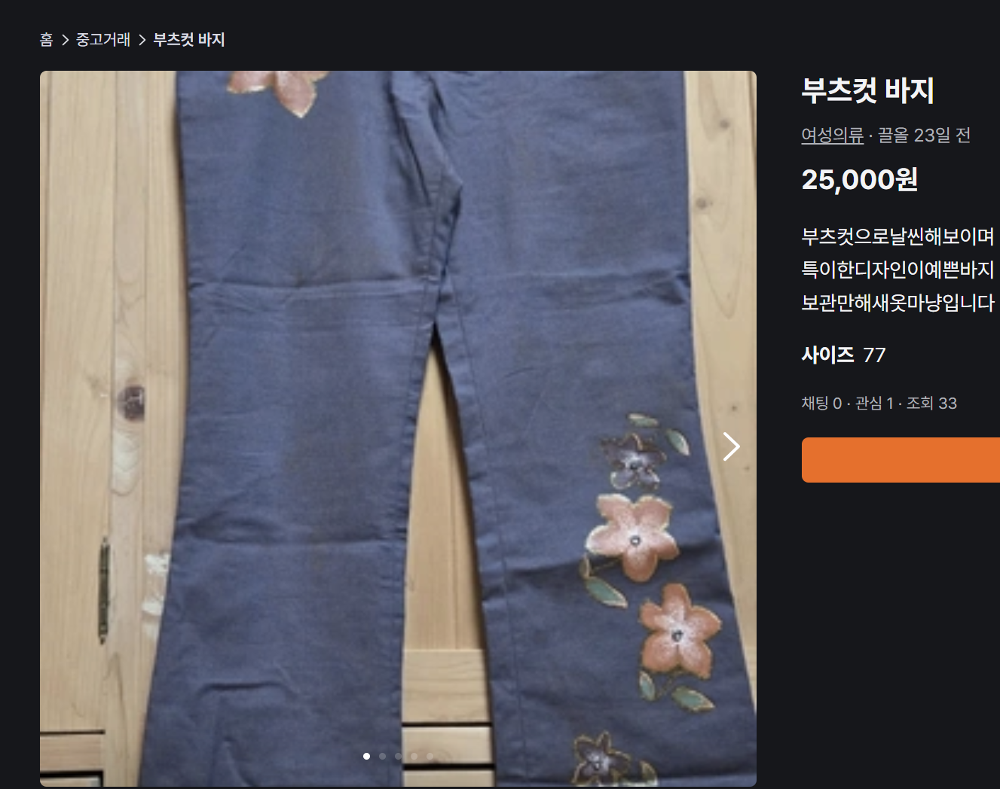
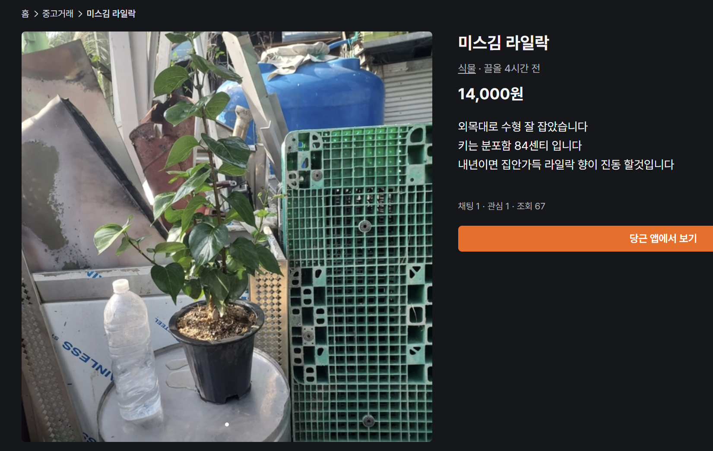
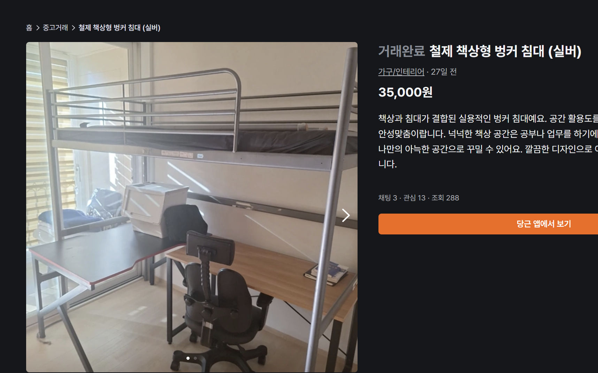
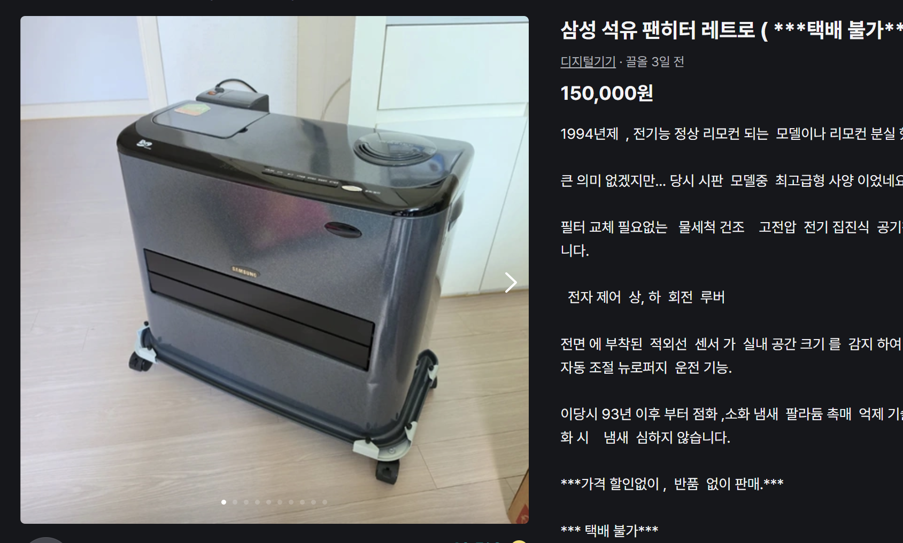
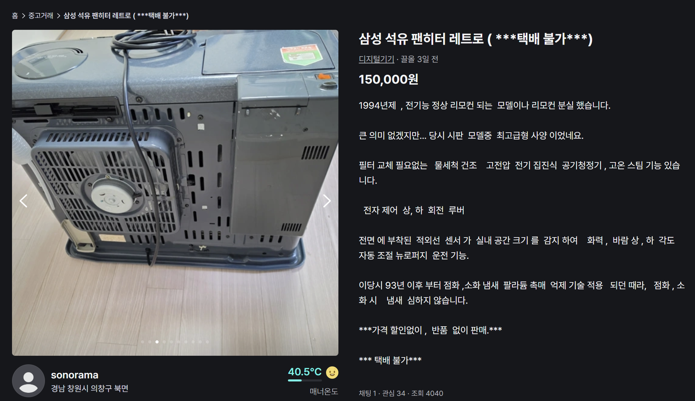

# 프로젝트 진행 방향 잡기
프로젝트를 진행할 때의 지침을 먼저 잡겠습니다.

우선 이전까지의 문제점을 한줄로 정리하면 **프로젝트를 진행할 때 너무 계획만 세우다 진행이 더뎌진 점**입니다.

이번에는 조금 더 불확실성을 제거해나가는 방식으로 구현을 해 볼 생각입니다.

---

## 1. 서비스 정의하기
이번 프로젝트에서는 ViT를 이용하여 이미지의 특징을 추출하여 사용자가 찍은 사진에서 부적절한 사진을 검수하고, CV를 이용하여 기본적인 품질에 대한 판단을 할 수 있지 않을까 생각이 들었습니다.

예를 들엇 사진이 노이즈가 있는지, 해상도, 선명도 등의 정보를 opencv및 numpy를 이용하여 걸러내고, ViT를 이용하여 전체 모습에서 특징들을 추출하여 뽑는 방식입니다.

#### ViT가 CV의 역할까지 할 수 있지 않을까요?
그런 생각을 하였지만 CV는 정량적으로 사람이 직접 선택해놓고 특징을 잡기 때문에 조금 더 결정 사유를 명확히 할 수 있습니다. 

추가로 원본 픽셀로부터 그대로 계산을 통해 값싼 계산 비용으로 이미지 품질을 평가할 수 있습니다.

> 그리고 그냥 공부용으로 쓰고싶습니다.

---

## 2. 무엇을 정의해야할까요?
> 그러면 이번 프로젝트에서 정의해야 할 요소가 1차적으로 정의될 수 있습니다.
- ViT와 CV가 이미지를 올바르게 분류할 수 있는지
- 올바른 이미지의 분류 기준을 무엇으로 삼을지
- ViT 흐름의 경우에는 어떻게 이미지가 잘못됨을 설명할지
- 입력의 형태와 출력의 형태는 어떻게 될 것인지

## 3. 먼저 해야할 일
우선 현장조사를 해보았습니다.

확인 된 것은 주관적으로 흐리거나 분간이 바로 되지 않는 이미지가 있다는 것이였습니다.
##### 주관적으로 애매한 사진
> 흐린 사진

> 배경이 산만함

> 햇살이 강함

##### 잘 뽑혔다 생각이 드는 사진
> 다각도에서 상대적으로 선명하게 찍혔음

> 이미지가 예쁘게 